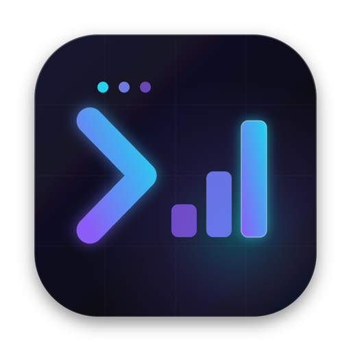
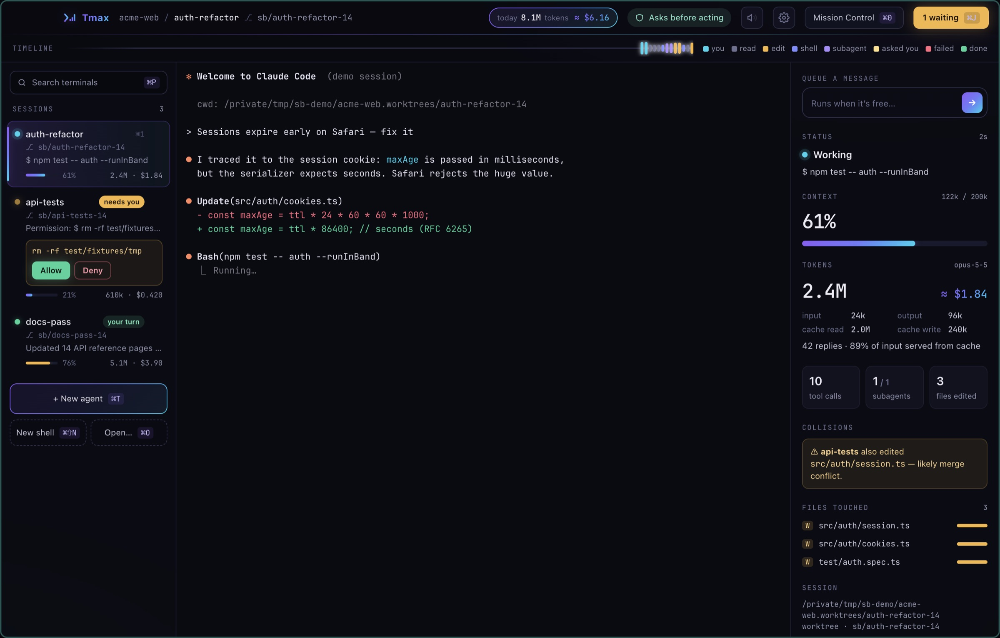

<p align="center">
  
</p>

<h1 align="center">Tmax</h1>

<p align="center">
  <b>A Mac terminal for running many Claude Code agents at once.</b><br>
  See what every agent is doing, approve its requests without switching tabs, and watch every token.
</p>

<p align="center">
  <a href="https://sreekumarkr777.github.io/tmax/">Website</a> ·
  <a href="#install">Install</a> ·
  <a href="#shortcuts">Shortcuts</a> ·
  <a href="CONTRIBUTING.md">Contributing</a>
</p>

<p align="center">
  
</p>

<p align="center"><sub>The real Tmax interface, shown with demo sessions and sample token numbers.</sub></p>

*Tmax = TokenMax.* Every tab is an agent session, optionally in its own git worktree, and the app always knows what each agent is doing.

> Tmax is an independent open-source project. It isn't affiliated with or endorsed by Anthropic.

## Install

You need **macOS**, **Node.js 18+** and **[Claude Code](https://docs.claude.com/en/docs/claude-code)** installed and signed in (`claude` on your PATH).

```bash
git clone https://github.com/sreekumarkr777/tmax.git
cd tmax
npm install      # node-pty ships a macOS prebuild; no compiler needed
npm start        # or double-click Tmax.app in the folder
```

To use a different Claude binary, run `TMAX_CLAUDE=/path/to/claude npm start`.

## What it does

- **Agent sessions.** Each one runs `claude` in a real terminal (xterm.js and node-pty). When Claude exits, the tab drops to a normal shell.
- **Worktree per agent.** Tick the box and the session gets its own worktree at `<repo>.worktrees/<name>` on branch `sb/<name>`.
- **Live status.** Claude Code hooks report every event to the app over localhost: working, needs you, your turn, error. Your own `~/.claude` settings are left untouched; the hooks are passed in with `--settings` for each session.
- **⌘J** jumps to the next agent waiting on you. A dock badge counts agents that need you, and you get a macOS notification when one needs you while the app isn't focused.
- **Mission Control (⌘0):** every agent as a card, plus a **collision warning** when two agents edit the same file.
- **Safety border.** The window frame turns teal, amber or red with the active session's permission mode.
- **Inspector.** Shows the context-window gauge (read from the session transcript), tool and subagent counts, files read and written, and Claude's last reply.
- **Timeline strip.** Every tool call appears as a colour-coded tick.
- **Answer without switching.** When an agent asks permission, its command shows in the sidebar, the inspector and Mission Control with **Allow** / **Deny** buttons (they press Enter / Esc in Claude's prompt for you). The inspector's reply box sends a message to the agent, or queues one while it's working.
- **Tokens and cost.** Each session's tokens (input, output, cache) and an estimated cost, read from its transcript, plus a "today" total in the title bar. Cost uses Anthropic API list prices; on a Claude plan it's the value used, not a bill.
- **Early warnings.** Context over 80% offers a one-click `/compact`. An agent failing three times in a row, or repeating the same step five times, is flagged "stuck?" with an Interrupt button. "Login expired" in Claude's output shows a **Sign in** button.
- **Always resumable.** New agents get their Claude conversation id up front (`--session-id`), so they resume after a restart even if you quit before sending a prompt.
- **Spoken alerts** (speaker button). For now this uses macOS `say` with a different voice per agent. Kokoro is the planned engine.

## Shortcuts

| Key | Action |
| --- | --- |
| ⌘T | New agent in the current folder (no form) |
| ⌘⇧T | New agent with options (folder, prompt, worktree, permissions) |
| ⌘O | Pick a folder and start an agent there (or drop a folder on the window) |
| ⌘⇧N | New plain shell |
| ⌘N | New window |
| ⌘D / ⌘⇧D | Split right (new shell) / close split |
| ⌘P | Search every terminal: session names, folders, commands and all output |
| ⌘F, ⌘G, ⌘⇧G | Find in terminal, next, previous |
| ⌘⇧E | Rename the current session (or double-click it, or the pencil icon) |
| ⌘K | Clear the terminal |
| ⌘J | Next agent that needs you |
| ⌘0 | Mission Control |
| ⌘1–9 | Switch session |
| ⌘I | Toggle inspector |
| ⌘, | Settings |
| ⌘W / ⌘⇧W | Close session / close window |
| ⌘= / ⌘- | Text size |
| ⌘⇧R | Reload the window (sessions and output are kept) |

Terminal basics: ⌘-click a link or a file path (`src/a.ts:42`) to open it, right-click for copy/paste/find/split, Option+←/→ jumps words while Option still types `#` and `€`, double-click a session to rename it, and drop files onto a terminal to type their paths.

Sessions come back after a restart: shells reopen in the folder you left them in with their output, and agents resume their Claude conversation (`claude --resume`). Turn this off in Settings.

## Privacy

Everything stays on your machine. Claude Code reports its activity to Tmax over `127.0.0.1` using a per-session hooks file passed with `--settings`; your own `~/.claude` settings aren't changed. Tmax has no server, account or analytics.

## Layout

```
main.js            Electron main: PTYs, hook server, notifications, voice, menu
preload.js         The only bridge between the UI and main
src/state.js       Hook events → session model (pure, unit-tested)
src/hooks.js       Localhost hook server + per-session --settings file
src/git.js         Repo detection and worktrees
src/transcript.js  Context gauge from the transcript JSONL
src/usage.js       Token and cost meter from the transcript JSONL
site/              Landing page (published with GitHub Pages)
renderer/          UI (plain HTML/CSS/JS, no build step)
test/              npm test, plus a headless screenshot smoke test
```

## Roadmap

Sessions that survive quitting (tmux-backed), rewind/fork from the timeline, best-of-N compare, inline diff review, and Kokoro voice with spoken commands.

## Contributing

Issues and pull requests are welcome. See [CONTRIBUTING.md](CONTRIBUTING.md).

## License

[MIT](LICENSE)
